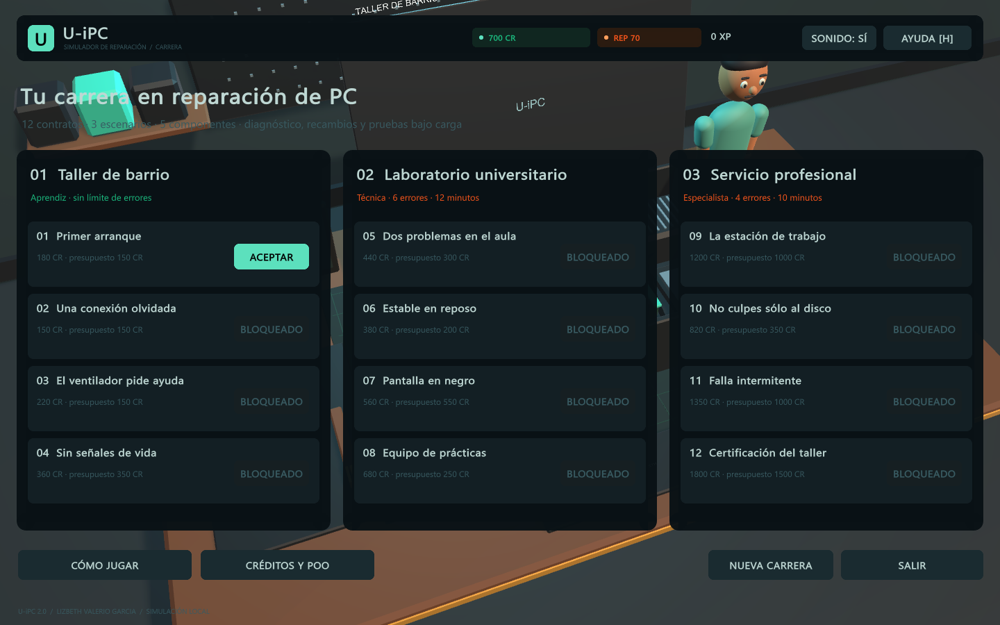
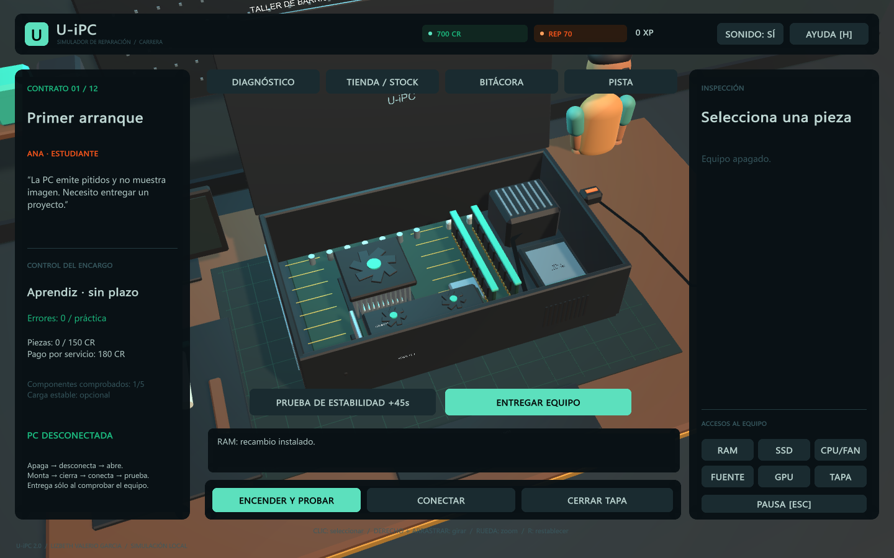
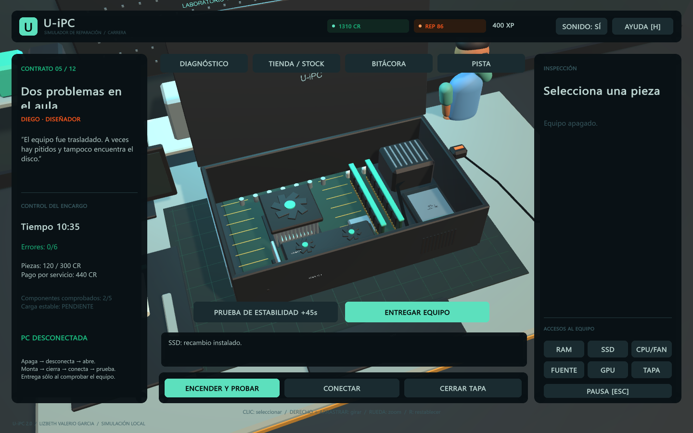
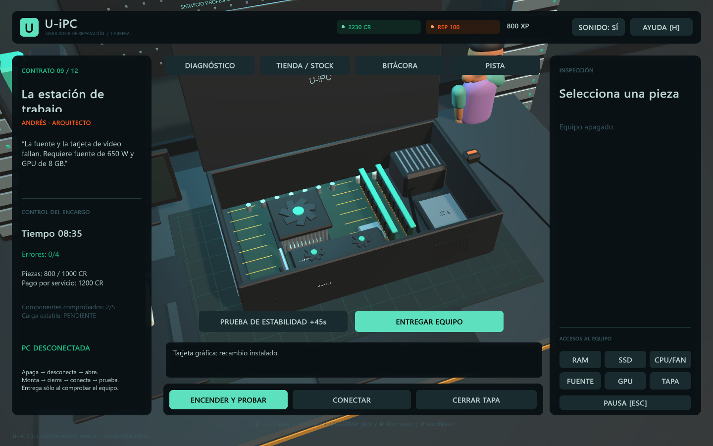
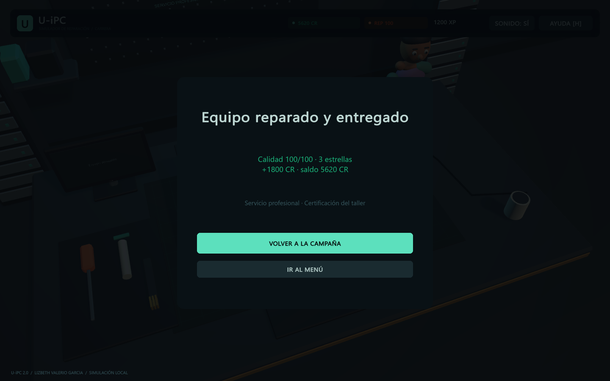

# Capturas de U-iPC 2.0

Capturas reales del ejecutable Windows, obtenidas durante el recorrido de verificación del 19 de noviembre de 2026. El perfil de pruebas tiene avance propio; una carrera normal comienza en el primer contrato. Las imágenes originales están en [capturas](capturas/).

## Campaña de doce contratos

El mapa organiza cuatro contratos por escenario. Muestra créditos, reputación, experiencia y el desbloqueo progresivo de la carrera.

## Taller de barrio: aprendiz

Los primeros encargos permiten practicar sin suspensión por tiempo o errores. La interfaz reúne el síntoma del cliente, los accesos a piezas y los controles de energía y tapa.

## Laboratorio universitario: dificultad técnica

El segundo escenario incorpora plazo, límite de errores y prueba de estabilidad. Los contratos combinan causas y requieren comprobar cada reparación.

## Servicio profesional: especialista

Los encargos avanzados exigen piezas con capacidad o potencia suficiente. Aquí aparecen el requisito de fuente de 650 W y GPU de 8 GB, el gasto del presupuesto y el límite de cuatro errores. Los botones superiores dan acceso al diagnóstico, tienda, bitácora y pistas.

## Entrega y resultado final

La reparación sólo se registra al verificar y entregar el equipo. El resultado presenta calidad, estrellas y recompensa del contrato.

Los tres escenarios comparten la cámara orbital y la estación de trabajo, con cambios de ambientación y mobiliario. Son talleres de simulación alrededor de una mesa.

[Descargar el juego Windows](https://github.com/AngelHS12-svg/U-iPc/releases/tag/v2.0.0) · [Guía de instalación](INSTALACION_WINDOWS.md) · [Manual de usuario](MANUAL_V2.md)
